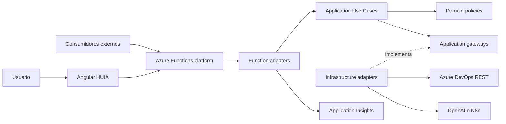
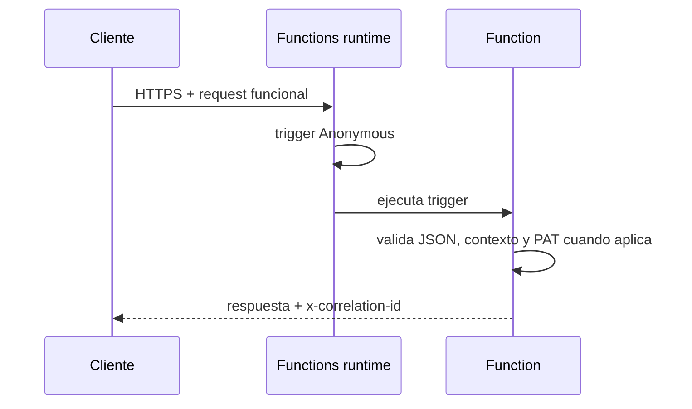

# Arquitectura del sistema

## Vista general

Angular concentra rutas en `api-contract.ts`, configuración en `ApplicationConfigurationService` y transporte en `ApiService`. La Function valida transporte, cuerpo, headers y contexto, transforma el request en un comando/query y delega. Application orquesta reglas sin conocer HTTP. Domain contiene políticas de campos y HTML. Infrastructure implementa proveedores IA, parser de arquitectura y adaptadores REST de Azure DevOps.

## Acceso HTTP

No hay autenticación de plataforma ni Function Key en el contrato. ARM declara CORS y TLS, pero CORS no protege frente a clientes no navegador. El estado efectivo y el acceso público deben probarse en Azure.

## Observabilidad

Application Insights se registra en `Program.cs`. Cada Function usa nombres lógicos de endpoint y correlation ID; `ErrorLoggingHelper` sanea y limita contexto. PAT, API keys y cuerpos sensibles no deben registrarse. El frontend transforma errores HTTP sin reutilizar la URL completa.
