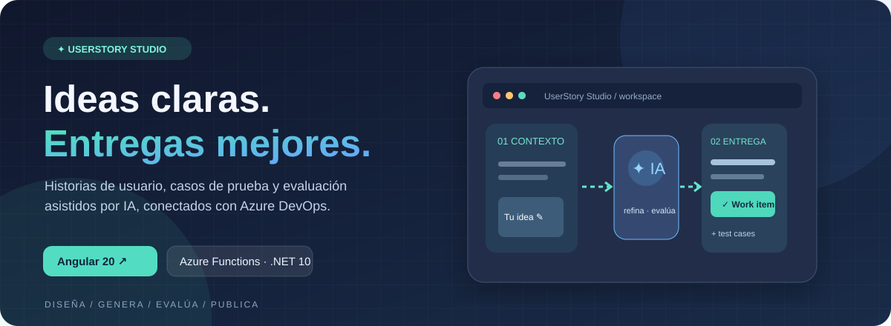
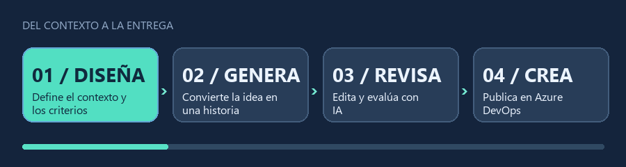
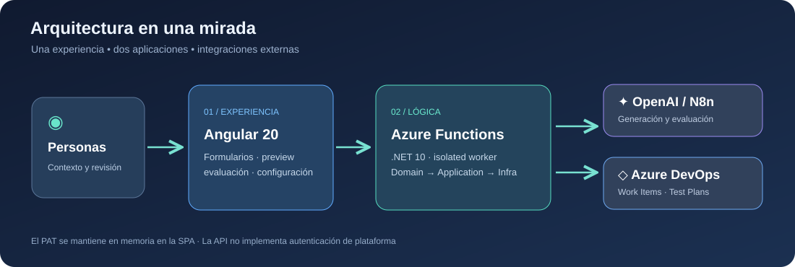

<div align="center">



# UserStory Studio

**Diseña · Genera · Revisa · Entrega**

De una necesidad de producto a historias de usuario y casos de prueba revisables, con asistencia de IA e integración con Azure DevOps.

[](IAHistoriasUsuario-FrontEnd/README.md)
[](IAHistoriasUsuario-APIFunction/README.md)
[](IAHistoriasUsuario-APIFunction/README.md)
[](IAHistoriasUsuario-APIFunction/docs/integrations/azure-devops.md)
[](LICENSE)

[Qué resuelve](#qué-resuelve) · [Ejemplo](#ejemplo-ilustrativo) · [Arquitectura](#arquitectura-y-decisiones) · [Inicio rápido](#inicio-rápido) · [Seguridad](#seguridad-y-límites)

</div>

## Qué resuelve

Una historia generada por IA puede sonar convincente y seguir sin estar lista para el backlog: faltan contexto, criterios verificables o revisión humana. UserStory Studio reúne las etapas de preparación, generación y entrega, manteniendo **la generación separada de la creación de elementos en Azure DevOps**.

| Etapa | En la aplicación |
| --- | --- |
| **Diseñar** | Aportar contexto funcional y configurar los campos pertinentes de Azure DevOps. |
| **Generar** | Solicitar borradores de historias y casos de prueba con OpenAI o n8n, según el proveedor configurado. |
| **Revisar** | Editar la vista previa y evaluar Work Items existentes para obtener hallazgos y recomendaciones. |
| **Entregar** | Crear Work Items, Test Cases y relaciones en Azure DevOps mediante operaciones explícitas. |

La IA propone material de trabajo; **la validación funcional y la decisión de publicar corresponden al equipo**. La API también ofrece capacidades que no son pantallas de esta SPA, como comentarios, importación de backlog de arquitectura y análisis de texto extraído de CV. La [matriz endpoint–consumidor](IAHistoriasUsuario-APIFunction/docs/traceability/endpoint-consumer-matrix.md) delimita lo implementado y los consumidores no verificados.

## Ejemplo ilustrativo

**Necesidad de ejemplo:** «Quiero filtrar las historias del backlog por estado para encontrar las pendientes de revisión».

> **Historia de usuario:** Como responsable de producto, quiero filtrar las historias por estado para identificar las pendientes de revisión sin recorrer todo el backlog.
>
> **Criterios de aceptación propuestos:**
>
> ```gherkin
> Escenario: Hay historias en el estado seleccionado
>   Dado que el backlog contiene historias en distintos estados
>   Cuando selecciono "Pendiente de revisión"
>   Entonces veo únicamente las historias de ese estado
>
> Escenario: No hay coincidencias
>   Dado que no hay historias en el estado seleccionado
>   Cuando aplico el filtro
>   Entonces veo un estado vacío informativo
> ```
>
> **Pruebas a considerar:** coincidencias, ausencia de resultados y cambio o limpieza del filtro.

Este ejemplo **no es una captura ni una respuesta real del modelo**. Ilustra cómo hacer observables los criterios sin inventar reglas de permisos o estados para un proyecto ajeno. La historia debe seguir siendo negociable (INVEST); los valores de estado y las reglas concretas se acuerdan con el equipo. La [referencia HTTP](IAHistoriasUsuario-APIFunction/docs/api/http-api-reference.md) contiene los contratos reales de generación y creación.

<div align="center"></div>

## Arquitectura y decisiones

<div align="center"></div>

```text
IAHistoriasUsuario-FrontEnd/   Angular 20 · SPA · formularios reactivos · Quill
IAHistoriasUsuario-APIFunction/
  ├─ API-HistoriasUsuarioIA.Function/        Triggers HTTP y configuración
  ├─ API-HistoriasUsuarioIA.Application/     Casos de uso y contratos
  ├─ API-HistoriasUsuarioIA.Domain/          Reglas de dominio
  ├─ API-HistoriasUsuarioIA.Infrastructure/  Integraciones externas
  └─ API-HistoriasUsuarioIA.Tests/           Pruebas
assets/                       Gráficos ilustrativos del repositorio
```

- **Azure Functions v4 / .NET 10 isolated worker:** la API ejecuta .NET en un proceso separado del host de Functions y expone doce operaciones HTTP `POST` bajo `/api/v1.0.0/...`.
- **Separación Domain / Application / Infrastructure:** concentra reglas y casos de uso fuera de los adaptadores de IA y Azure DevOps. Esta organización facilita revisar integraciones sin mezclar transporte y dominio; no implica por sí sola que cualquier proveedor sea intercambiable sin trabajo.
- **Angular 20:** componentes standalone y un servicio centralizado para construir peticiones. La base de la API local se incorpora al bundle al compilar; no es configuración dinámica en el navegador.
- **Resultados parciales:** la creación de elementos puede responder `207 Multi-Status`. Ante un timeout, se debe verificar el estado en Azure DevOps antes de repetir la solicitud; no se presume atomicidad entre recursos.

Más detalles: [arquitectura backend](IAHistoriasUsuario-APIFunction/docs/architecture/system-architecture.md), [arquitectura frontend](IAHistoriasUsuario-FrontEnd/docs/FRONTEND_ARCHITECTURE.md) y [referencia HTTP](IAHistoriasUsuario-APIFunction/docs/api/http-api-reference.md).

## Inicio rápido

**Requisitos:** .NET SDK 10, Azure Functions Core Tools v4, Node.js/npm y Azurite si se mantiene `AzureWebJobsStorage=UseDevelopmentStorage=true`. Para generar mediante IA hay que configurar el proveedor seleccionado. Las operaciones que consultan o crean elementos en Azure DevOps requieren un PAT con los permisos correspondientes; **generar un borrador no requiere PAT**.

Desde la raíz del repositorio, inicia Azurite en una terminal si usas almacenamiento de desarrollo:

```sh
azurite
```

En otra terminal, inicia la API. **Antes de arrancarla**, edita la copia local de configuración y sustituye los marcadores necesarios para el proveedor seleccionado.

<details>
<summary>PowerShell (Windows)</summary>

```powershell
cd .\IAHistoriasUsuario-APIFunction
Copy-Item .\API-HistoriasUsuarioIA.Function\local.settings.example.json .\API-HistoriasUsuarioIA.Function\local.settings.json
dotnet restore .\API-HistoriasUsuarioIA-funcion.sln
func host start --script-root .\API-HistoriasUsuarioIA.Function --port 7071 --cors http://localhost:4200
```

</details>

<details>
<summary>Bash (macOS / Linux / WSL)</summary>

```bash
cd IAHistoriasUsuario-APIFunction
cp API-HistoriasUsuarioIA.Function/local.settings.example.json API-HistoriasUsuarioIA.Function/local.settings.json
dotnet restore API-HistoriasUsuarioIA-funcion.sln
func host start --script-root API-HistoriasUsuarioIA.Function --port 7071 --cors http://localhost:4200
```

</details>

Desde **la raíz del repositorio, en otra terminal**, inicia el frontend:

```sh
cd IAHistoriasUsuario-FrontEnd
npm ci
npm run start:local
```

Abre `http://localhost:4200`. La configuración `local` del frontend apunta a `http://localhost:7071/api`. Este recorrido usa HTTP **solo en localhost**. Si optas por HTTPS local, configura explícitamente la base HTTPS, el certificado de Core Tools y el origen CORS correspondiente; no se cambia de protocolo automáticamente. Véase la [configuración frontend](IAHistoriasUsuario-FrontEnd/docs/FRONTEND_CONFIGURATION.md).

### Configuración que conviene conocer

El archivo de ejemplo incluye muchos límites y valores por defecto; la referencia completa es [APP_SETTINGS.md](IAHistoriasUsuario-APIFunction/API-HistoriasUsuarioIA.Function/APP_SETTINGS.md).

| Clave | Función |
| --- | --- |
| `AzureWebJobsStorage` | `UseDevelopmentStorage=true` requiere Azurite. |
| `FUNCTIONS_WORKER_RUNTIME` | `dotnet-isolated` en la configuración local. |
| `AiConnection__Provider` | Selecciona el proveedor IA configurado. |
| `AiConnection__OpenAI__ApiKey` / `AiConnection__N8n__Url` | Configura únicamente la alternativa elegida; no publiques credenciales ni webhooks. |
| `AzureDevOps__Defaults__Organization` / `AzureDevOps__Defaults__Project` | Contexto por defecto cuando la operación lo admite; no sustituye al PAT. |
| `x-azdo-pat` | Encabezado de las solicitudes que usan Azure DevOps; **no es una App Setting**. |

La configuración de la API está en `IAHistoriasUsuario-APIFunction/API-HistoriasUsuarioIA.Function/local.settings.json` (ignorada por Git). El PAT se introduce en la SPA y permanece en memoria; evita incluir credenciales o datos personales en capturas y ejemplos.

## Verificación local

Desde `IAHistoriasUsuario-APIFunction`:

```sh
dotnet build API-HistoriasUsuarioIA-funcion.sln
dotnet test API-HistoriasUsuarioIA-funcion.sln
```

Desde `IAHistoriasUsuario-FrontEnd`:

```sh
npm run lint
npm run test:ci
npm run build:local
```

`test:ci` requiere Chrome Headless. Estas comprobaciones locales **no certifican** un despliegue ni la disponibilidad de OpenAI, n8n o Azure DevOps. Evita usar credenciales o recursos reales para pruebas de humo; la creación en Azure DevOps puede modificar un proyecto y las llamadas a IA pueden consumir cuota.

## Seguridad y límites

> [!WARNING]
> Los doce endpoints HTTP declaran `AuthorizationLevel.Anonymous`. **CORS no autentica** y no impide llamadas de clientes fuera del navegador. No expongas una instancia con proveedores de IA o Azure DevOps configurados sin controles adecuados de acceso, cuotas y protección contra abuso.

La SPA conserva el PAT en memoria y lo envía cuando corresponde en `x-azdo-pat`; las claves del proveedor IA pertenecen al backend. `local.settings.json` y archivos `.env` están excluidos del repositorio. La presencia de plantillas ARM o configuración de ambientes **no demuestra** que exista un despliegue activo ni que sus controles estén aplicados. Consulta la [arquitectura de seguridad](IAHistoriasUsuario-APIFunction/docs/security/security-architecture.md) antes de publicar una instancia.

## Documentación

| Necesidad | Referencia |
| --- | --- |
| Explorar pantallas y flujos | [Frontend](IAHistoriasUsuario-FrontEnd/README.md) · [Flujos de usuario](IAHistoriasUsuario-FrontEnd/docs/FRONTEND_FLOWS.md) |
| Integrar otro consumidor | [Referencia de los doce endpoints](IAHistoriasUsuario-APIFunction/docs/api/http-api-reference.md) · [Matriz endpoint–consumidor](IAHistoriasUsuario-APIFunction/docs/traceability/endpoint-consumer-matrix.md) |
| Configurar y operar | [Desarrollo backend](IAHistoriasUsuario-APIFunction/docs/development/local-development.md) · [Configuración frontend](IAHistoriasUsuario-FrontEnd/docs/FRONTEND_CONFIGURATION.md) |
| Profundizar en diseño y pruebas | [Índice técnico backend](IAHistoriasUsuario-APIFunction/docs/README.md) · [Pruebas frontend](IAHistoriasUsuario-FrontEnd/docs/FRONTEND_TESTING.md) |

## Licencia

El código y los gráficos originales de este repositorio se distribuyen bajo la [licencia Apache 2.0](LICENSE). Las dependencias externas conservan sus respectivas licencias. La licencia no concede derechos sobre marcas o materiales de terceros. Los archivos de `assets/` son ilustrativos: no son capturas de una instancia desplegada.
